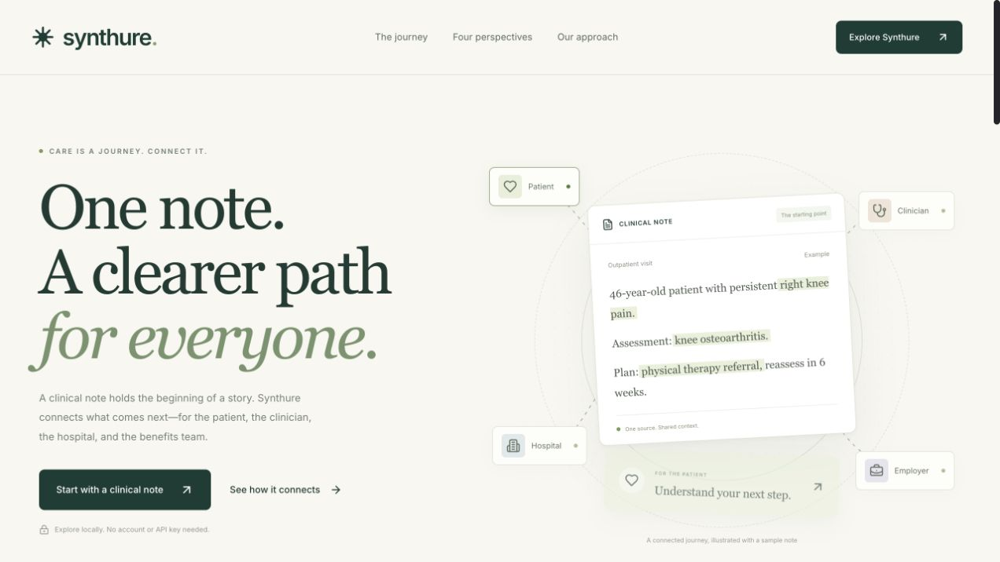
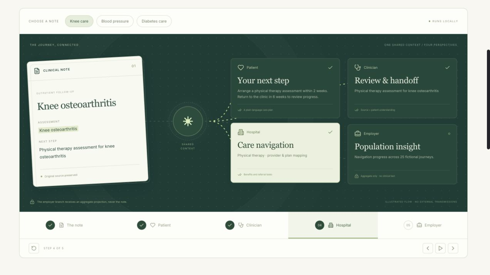

# Synthure

**One care journey. Four connected perspectives.**

Synthure is a healthcare navigation prototype that connects patient understanding, care coordination, and provider and benefit-plan decisions. A shared journey carries source-linked instructions, questions, preferences, and task updates across patient, clinician, hospital, and employer views.



## What it explores

- **Understanding care:** source-linked explanations, next steps, and teach-back responses for clinician review.
- **Communicating across teams:** shared questions, task ownership, review status, and service-specific authorization records.
- **Finding care and understanding spending:** fictional provider comparisons and transparent plan scenarios, including a trained synthetic preference-ranking demo.

| Perspective | Workspace |
| --- | --- |
| Patient | Understand the plan, raise questions, check understanding, and record care preferences |
| Clinician | Review source information, patient responses, and the care plan |
| Hospital | Coordinate tasks, see preferences, and record authorization evidence |
| Employer | Explore aggregate navigation activity across an authored fictional cohort |

The main demo runs without API keys. Three fictional example journeys cover knee care, blood pressure follow-up, and diabetes follow-up. A conservative local parser also accepts labelled synthetic notes; unsupported details remain unknown.



## Quickstart

Requires **Node.js 20.9+** and npm.

```sh
git clone https://github.com/aravinds-kannappan/Synthure.git
cd Synthure/frontend
npm ci
npm run dev -- --hostname 127.0.0.1 --port 3000
```

Open [Synthure locally](http://127.0.0.1:3000). On macOS, the optional [`Start Synthure.command`](Start%20Synthure.command) launcher starts the same local server.

| Route | Experience |
| --- | --- |
| [/demo](http://127.0.0.1:3000/demo) | Interactive workspace with four connected perspectives |
| [/journey](http://127.0.0.1:3000/journey) | Animated walkthrough of a connected care journey |
| [/insurance](http://127.0.0.1:3000/insurance) | Trained synthetic preference model and fictional plan comparisons |
| [/research](http://127.0.0.1:3000/research) | Approach, model tracks, and capability boundaries |
| [/evals](http://127.0.0.1:3000/evals) | Synthetic evaluation and separately labelled historical clinical benchmarks |
| [/lab](http://127.0.0.1:3000/lab) | Optional clinical research pipeline using an external model API |

**Try the shared workflow:** open the knee example, complete “Check my understanding,” and save a provider preference. Switch to Clinician to review the response, then Hospital to update an assigned task. The employer view reflects aggregate activity from the fictional cohort. These interactions simulate coordination within one browser session.

## Trained synthetic preference model

The `/insurance` demo uses a pairwise linear ranker fitted to labels generated by an authored preference policy. It compares three fictional plans using cost, provider-access, and user-preference features. A separate deterministic rule orders plans by monthly-budget feasibility; cost calculations and sample network matches come from authored tables.

| Supplied run | Result |
| --- | --- |
| Training set | 1,200 synthetic scenarios; 3,600 plan rows |
| Held-out set | 300 distinct synthetic scenarios; 900 plan rows |
| Top-ranked policy agreement | 98.0%, including the deterministic budget-first rule |
| Pairwise policy agreement | 96.6%, evaluating learned scores alone |
| Reproduction seed | `20261116` |

These metrics measure **fidelity to the synthetic policy**, not real patient preference, insurance suitability, coverage, savings, or clinical outcomes. Training and holdout share the same policy and fictional plan catalog. Scores are ranking values, not calibrated probabilities. Raw clinical notes are not model inputs.

Reproduce the dataset, fitted weights, and evaluation from the repository root using Python 3:

```sh
python3 -B models/insurance-ranking/synthetic_train.py
```

The script writes the [runtime model](frontend/lib/insurance-demo-model.json) and [training artifacts](models/insurance-ranking/synthetic-artifacts/). The [insurance research kit](models/insurance-ranking/README.md) also contains a separate verified-data trainer, which **has not been trained on verified data**. The rule-based comparison in `/demo`, trained synthetic model in `/insurance`, and verified-data trainer are distinct paths.

## Architecture

| Location | Responsibility |
| --- | --- |
| [`frontend/`](frontend/) | Next.js 15, React 19, and TypeScript application |
| [`frontend/lib/journey.ts`](frontend/lib/journey.ts) | Shared journey state, source-linked examples, task transitions, and aggregate projection |
| [`frontend/lib/insurance-demo.ts`](frontend/lib/insurance-demo.ts) | Browser-side ranking, fictional cost arithmetic, and sample network matching |
| [`models/insurance-ranking/`](models/insurance-ranking/) | Reproducible synthetic training and the separate verified-data research kit |
| [`frontend/app/api/synthesize/`](frontend/app/api/synthesize/) | Optional server-side clinical synthesis and report-release checks |
| [`ml/`](ml/) | Clinical model training and evaluation tooling |

## Capability boundaries

- `/demo` and `/insurance` compute locally. Journey content stays in browser memory and clears on refresh; the demo does not transmit messages, bookings, referrals, payer requests, or claims.
- Providers, plan rates, network mappings, and the employer cohort are fictional. Actual eligibility, coverage, network participation, and availability are unverified. An authorization approval does not establish coverage.
- Role switching demonstrates perspectives; it is not authentication. The employer projection excludes individual clinical content and suppresses pasted-note journeys, but it is not a production privacy or access-control system.
- Teach-back supports clinician review; it does not automatically establish comprehension. Historical clinical benchmarks are separate from the synthetic model and do not validate the complete care workflow.
- A real pilot needs verified data, organization access controls, durable task ownership, approved data processing, actual integrations and acknowledgments, and prospective patient and staff evaluation.

## Optional clinical research pipeline

`/lab` retains the clinical pipeline using browser-hosted OpenMed models and `/api/synthesize`. To enable its server calls, set `ANTHROPIC_API_KEY` in `frontend/.env.local`.

**Running `/lab` sends processed note text to Anthropic.** The local processing boundary of `/demo` does not apply to this route. Use synthetic notes for demonstrations. Report-release checks withhold outputs when review or blocking is required; these checks are not clinical validation.

## Validation

From `frontend/`:

```sh
npx tsc --noEmit
npm run build
npm run grade-guardrails
npm run grade-harness
npm run redteam-agents
npm run grade-journey
npm run grade-insurance
```

For the insurance training utility, from `models/insurance-ranking/`:

```sh
python3 -m unittest test_train.py
```

## Attribution

See [`NOTICE`](NOTICE) for OpenMed model, runtime, and public-data attributions.
